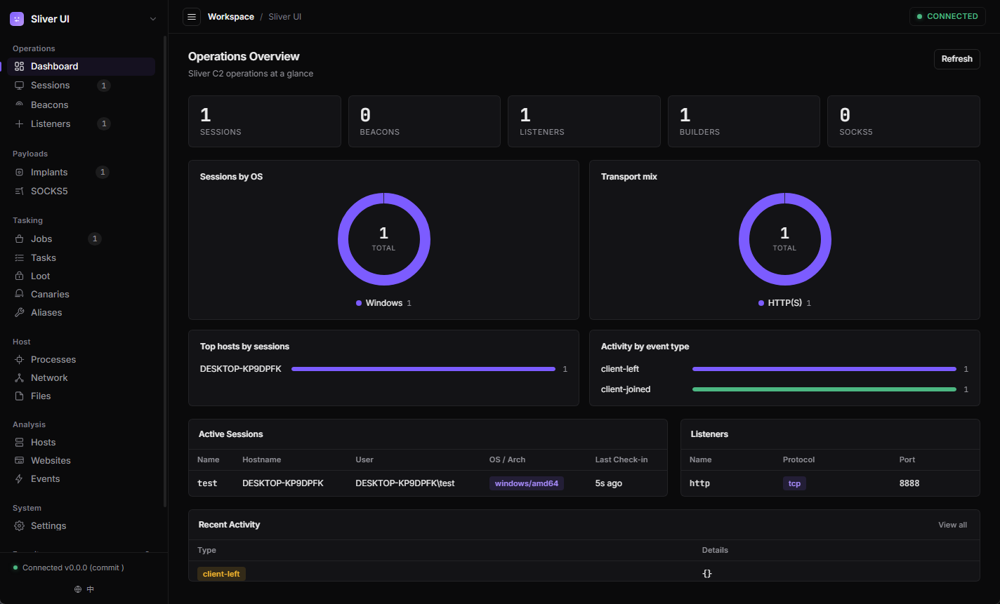
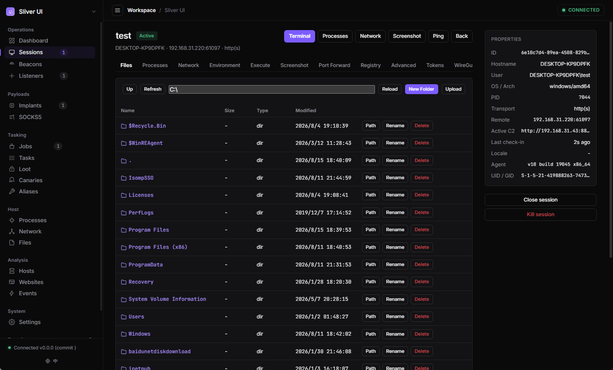
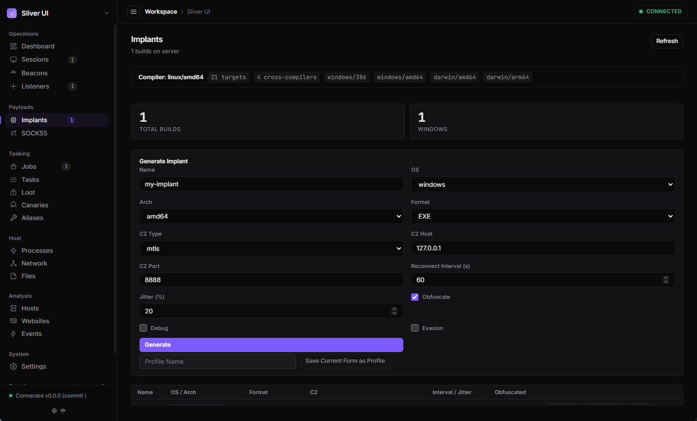
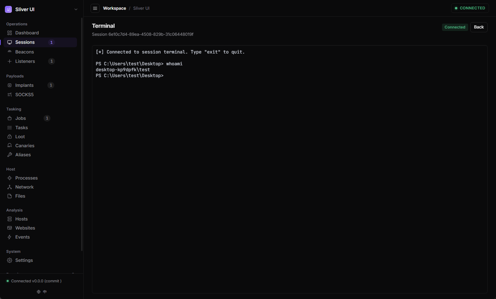

# Sliver UI

<p align="center">
  <strong>A modern web & desktop interface for Sliver C2</strong><br>
  <a href="./README.md">English</a> · <a href="./README.uz.md">Oʻzbekcha</a>
</p>

<p align="center">
  <a href="https://github.com/9Insomnie/sliver_ui">
    
  </a>
  <a href="https://github.com/9Insomnie/sliver_ui/issues">
    
  </a>
  <a href="https://github.com/9Insomnie/sliver_ui">
    
  </a>
  <a href="https://github.com/9Insomnie/sliver_ui/releases">
    
  </a>
  <a href="./LICENSE">
    
  </a>
</p>

**Sliver UI** is a graphical console for operating [Sliver](https://github.com/BishopFox/sliver) — the open-source adversary simulation / C2 framework. The backend is a **Sliver client**: it authenticates to a Sliver server over native gRPC (mTLS + token) and exposes operations through an HTTP API. The React frontend renders them in a browser or a native Windows WebView2 window.

Everything ships as a **single static binary**. The built frontend is embedded with `go:embed`.

This tree is a fork of [`9Insomnie/sliver_ui`](https://github.com/9Insomnie/sliver_ui) with operator login, `install.sh`, HTTP C2 editing, host-compile Loaders, and the P0/P1 operator-console work described below. Lab / authorized red-team use only.

```text
┌───────────────────────────────┐
│  Browser / WebView2 window    │
│  Sliver UI (React + xterm.js) │
└──────────────┬────────────────┘
               │  HTTP API / WebSocket
               ▼
┌───────────────────────────────┐
│  Go backend  (sliver client)  │
│  embedded frontend + API      │
└──────────────┬────────────────┘
               │  gRPC / RPC (mTLS + token)
               ▼
┌───────────────────────────────┐
│  Sliver Server                │
│  sessions · beacons · jobs    │
└───────────────────────────────┘
```

Protobuf pin: `github.com/bishopfox/sliver` **v1.7.3**. Live lab in this fork has been Sliver **1.7.9**. `GET /api/builders` still returns implant builds under JSON key `"builders"`. Remote builder stations are `GET /api/external-builders`. Route `/jobs` stays.

## Screenshots

| | |
| :-: | :-: |
| **Dashboard** — live overview of sessions, beacons, listeners and SOCKS | **Sessions** — table/graph, tags, compare, privilege highlight |
|  |  |
| **Implants** — generate with C2 vs jobs, SHA-256, limits, canary | **Terminal** — full-screen xterm.js shell per session |
|  |  |

## Honest OPSEC

Obfuscate and Evasion are compile-time flags. Unique SHA-256 beats **exact-hash lookup only**; VirusTotal still sandboxes a new hash. The Go loader runtime still contains `VirtualAlloc` / `CreateThread` / `kernel32.dll`. HTTP C2 copy in the UI: **“This still looks like default Sliver to public detectors.”** Spoof metadata is a PE VERSIONINFO/icon clone, not FUD. Do not claim VirusTotal 0/70 or an AV/ML bypass.

Tracking: [`docs/P1_OPERATOR_WORK.md`](./docs/P1_OPERATOR_WORK.md) · research: [`reports/Sliver UI imkoniyatlar tahlili.md`](./reports/Sliver%20UI%20imkoniyatlar%20tahlili.md) · loaders: [`docs/LOADER_AV_OPSEC_PLAN.md`](./docs/LOADER_AV_OPSEC_PLAN.md) · AV layers close: [`docs/AV_LAYERS_CLOSE_PLAN.md`](./docs/AV_LAYERS_CLOSE_PLAN.md)

---

## What was done

Work shipped in this fork, grouped by phase.

### 1. Product shell

- Single-binary embed (`frontend/dist` → `backend/web/dist` → `go:embed`).
- Linear-like dark UI: `#0a0a0b` / `#131316` / accent `#7c5cff`, Inter 13px.
- i18n **English + 简体中文** in lockstep (`i18n.test.ts` fails if key trees diverge).
- Favorites, collapsed sidebar, ⌘K / Ctrl+K command palette (pages, sessions, beacons, generate, listen).
- Sign out in the topbar. Settings stays under System. Jobs dropped from the sidebar (route `/jobs` kept; Listeners already lists jobs).
- Empty dashboard charts hidden when there is no data. Builders card copy is “Builds”.

### 2. Auth, install, systemd

- UI login from `SLIVER_UI_USER` / `SLIVER_UI_PASS` (`~/.config/sliver-ui/env`).
- Cookie `sliverui_session` HttpOnly SameSite=Lax 24h (no Secure; in-process map, restart clears sessions).
- Middleware protects `/api/*` and `/ws/*`. Login, `/api/auth/me`, and the SPA stay public.
- [`install.sh`](./install.sh): binary, profile mirror `*.cfg` → `*.json`, localhost profile auto-pick, env file, `sliver-ui.service`, `Wants=` from `sliver.service`.
- Flags: `--addr`, `--profile`, `--user`/`--pass`, `--no-auth`, `--build`, `--with-server` (default), `--no-server`, `--replace-server`, `--prefix`, `--skip-systemd`, `--no-start`.
- `--with-server` clones BishopFox/sliver **v1.7.3** into `third_party/sliver/` (gitignored), applies **generator patches** (Donut none, StartW-only exports, inline max-errors, per-generate polymorph) plus a **shared proto name map** (`patches/sliver-v1.7.3/proto-idents.json`, same seed on server and UI). Builds `sliver-server` + `sliver-client`, installs them next to the UI, issues a `127.0.0.1:31337` operator (`--permissions all`), and writes `sliver.service`. Rebuild both after a proto Apply. `--replace-server` overwrites a live `sliver.service`.
- Default listen `127.0.0.1:8080`. Windows GUI-subsystem + WebView2; Linux/macOS HTTP. Logs on Windows mirrored to `sliver-ui.log`.

### 3. Loaders / AV OPSEC (`/loaders`)

Host-compile a **finished** PE / ELF / Mach-O — `POST /api/loaders/build` writes a temp Go module and `GOOS/GOARCH CGO_ENABLED=0 go build`. The UI downloads the binary. There is no ZIP + local-compile path for the primary flow.

- Empty XOR key replaced with a random 16-byte key (embed is never plaintext).
- Every build mints a 16-byte nonce mixed into XOR, 4–24KiB `n.bin` pad, random API-name `NameKey`, Go `-buildid` → **SHA-256 always changes** even with the same operator XOR key.
- Hide-console / background default on (`-H windowsgui` on Windows; Unix setsid) — independent of persistence. Startup persistence default off: pick one method, or **All** (Windows: HKCU Run + schtasks ONLOGON + Startup copy; Linux: user systemd + crontab `@reboot`; Darwin: LaunchAgent only, no All). Usual quiet Windows pick is HKCU Run. All is noisier (three artefacts).
- Windows **amd64/386** wrap is **MinGW C** on the UI host (`x86_64-w64-mingw32-gcc` / `i686-w64-mingw32-gcc`, `#embed`, ~tens of KiB + blob). Missing mingw → HTTP 503. **windows/arm64** and Linux/macOS stay on the Go stub. C wrap drops Go PE-shape ML (`gopclntab` / Wacatac class); it does **not** hide `sliverpb` in memory or keep a live session from Defender. XOR `cfg.dat`; PAGE_NOACCESS → RW → RWX; 8MiB stack + `CALL`; hang if PIC returns (`SLIV_BG=1` skips). RAM gate 2 GiB; computer name `HAL9TH` exits.
- Wrap of a Windows **EXE** is rejected (generate `format=shellcode`). Shared DLLs default to **disk LoadLibrary** (C EXE + sibling DLL, export StartW, `engine=mingw-c-dll`); Tools → RDI is the unbacked PIC path. Windows wrap also **same-length branding clean**. Loaders → **Sliver fork** tab (`POST /api/fork/rewrite`) rewrites a local Sliver checkout: branding (module path; this UI still works) or proto (RPC names; rebuild this UI with `go mod replace`). Not a Defender guarantee.
- Linux PIC (malasada): mmap RWX, fork/clone, assembly `CALL` on 8MiB stack (`jump_linux_*.s`). `syscall.Syscall(addr)` is a syscall trap, not a jump.
- Also: Sliver RDI, SGN/XOR shellcode encoders, TCP stage listeners with optional AES/RC4. Windows shellcode generate defaults Donut **Bypass=1** (no AMSI patch; CLI default 3 is signatured) and **ExitOpt=3** (block). Unique SHA-256 is a hash-IOC change, not a Defender bypass.
- Generate **Polymorph** (default on): unique name suffix, force obfuscate, Donut entropy 3 when unset, per-download branding clean of returned bytes. Protobuf RPC names stay. Wrap C idents morph per build. Fork proto Apply uses a new random seed each time.
- Implant `implant_builds.name` UNIQUE: mapped error + `replace_existing`.
- **Rejected / not redone:** in-tree Donut or ScareCrow, encrypt-at-rest as an Implants FUD checkbox, VirusTotal widget.

### 4. HTTP C2

- Pages `/http-c2`: list + JSON editor, templates `ms-update` and `jquery-cdn`.
- RPCs: `GetHTTPC2Profiles` / `GetHTTPC2ProfileByName` / `SaveHTTPC2Profile`. List hydrates by name before fingerprinting.
- Default-fingerprint helper: “This still looks like default Sliver to public detectors.”
- TrafficEncoder map, **Add / Rm**, generate-time encoder pick.
- HTTP listener camouflage: website, domain, ACME, OTP, long-poll.
- Generate fields: `http_c2_profile`, `traffic_encoders*`, `limit_*`.

### 5. P0 — operator table-stakes

| Item | What shipped |
|---|---|
| Events | In-process ring (~500) + `/ws/events` with poll fallback. Beacon events unmarshaled from proto `Event.Data` (v1.7.3 has no `Event.Beacon` field). |
| Beacon generate | `is_beacon`, interval/jitter on the generate form. |
| Beacon tasking | `Request.BeaconID` for ls / ps / exec / screenshot + `CancelBeaconTask`. Open-session delay / C2s. |
| External builders | `GET /api/external-builders` → `Builders()`. Old `/api/builders` stays ImplantBuilds under `"builders"`. |
| Operators | `GetOperators` page. |
| ⌘K palette | Navigate pages, sessions, beacons, generate, listen. |
| C2 vs jobs | Implant / session `ActiveC2` matched to live jobs by **name + port** (Job.Protocol is often `tcp`). |
| SHA-256 | Generate / regenerate / download; warn on collision across **different** names. |
| Screenshot / file → loot | `LootAdd` so captures survive tab unmount. |
| Canary on generate | `CanaryDomains` field + Canaries page. |
| Armory | Minisign HTTP index; install writes **this UI process’s** `aliases/` directory. |

### 6. P1 slice 1

| Item | What shipped |
|---|---|
| Sessions graph | Table / graph toggle over `PivotGraph()`. Privilege highlight (`UID==0` or SYSTEM/root/Administrator). SOCKS / portfwd monitor strip. Latency is not invented. |
| Files recents | Per host UUID, cap 8, Backspace-up. |
| Loot report | `GET /api/loot/report?format=json\|md`. Notes credential *presence*; does not dump passwords. |
| Generate limits | `limit_datetime`, `limit_file_exists`, `limit_locale`. |
| External builder picker | `GenerateExternal` + wait on `external-acknowledge` / failed / completed, then `Regenerate`. |
| Spoof metadata | `GenerateSpoofMetadata` PE source/icon — resource clone, not FUD. |
| Beacon / session reconfigure | UI seconds → backend nanoseconds (`time.Second`). Generate interval units stay seconds. |
| BOF / extension run | From aliases (`aliasRun` / `callExtension`). |
| PsExec default | Bland `OneDrive Updator` (was `Sliver`). |

### 7. P1 remaining

| Item | What shipped |
|---|---|
| Wasm extensions | Register / list / exec on sessions and beacons. gzip BestSpeed, 64 MiB cap, memfs, loot. Session **pipe** drains the tunnel until exit or **60s** — not a live TTY. Beacons cannot pipe. Distinct from HTTP-C2 traffic-encoder Wasm. Handler file is `handlers_wasiext.go` (`*_wasm.go` is ignored as `GOARCH=wasm`). |
| rportfwd | Start / Get / Stop on **v1.7.3** RPCs (no go.mod bump). Implant listens; teamserver dials. Port-only bind → `:port`; port-only remote → `127.0.0.1:port`. DNS ActiveC2 warning still starts. Teamserver owns reverse-tunnel I/O (`rtunnels.TrackListener`). |
| Notes / tags / campaign | Local JSON keyed by Sliver UUID. Path: `$SLIVER_UI_DATA` or `~/.local/share/sliver-ui/operator-store.json`. |
| Advisory lock | Banner “admin is on this session”. `sliver-client` ignores it. Hard lock needs a new Sliver RPC. |
| Reactions | Allowlist `whoami` / `ps` / `pwd` / `ifconfig` / `screenshot`. Disk format matches `~/.sliver-client/reactions.json` (`event_type` + `commands`). Not a sliver-client REPL. |
| Who-ran-what | MUTATE log: cookie user + Sliver operator name (`Client.Profile`). Other sliver-client operators are invisible. Full audit needs a new Sliver RPC. Cap 500. |
| Session compare | Pick two sessions; diff host, user, C2, local tags. |

Session workspace is **15 tabs**: files, processes, network, env, exec, screenshot, portfwd, **rportfwd**, registry, advanced, **wasm**, tokens, wg, pivot, services — plus a separate `/sessions/:id/terminal`. Beacon detail mounts Wasm (no pipe) and notes.

---

## What still needs to be done

P0 and P1 from the capability report are **done**. What is left is P2 / later, plus a few honest limits of the current slice.

### Next operator work (P2)

| Item | Why it is still open | Fit |
|---|---|---|
| Interactive Wasm TTY | Current pipe drains until exit or 60s | Existing tunnel + live xterm; larger UX |
| Hard session lock | Advisory lock is UI-host only; CLI ignores it | **New Sliver RPC** |
| Full multi-operator audit | This UI only logs its own MUTATE + this Sliver profile | **New Sliver RPC** |
| File extras: grep, cp, chmod, memfiles, mount | Partial FS surface | Existing Sliver RPCs |
| Listener RestartJobs, DNS canary/no-txt, cert RPCs | Listeners still share the jobs table | Existing Sliver RPCs |
| Generate named-pipe / TCP pivot C2 | Form covers mTLS/HTTP/HTTPS/DNS/WG | Existing Generate fields |
| Crackstation | Proto exists, niche lab use | Existing Sliver RPC |
| Batch “generate N unique hashes from a profile” | Operators repeat generate for hash IOC | Backend helper looping Generate |
| Ghostwriter / `mythic_sync` | Reporting after attributed tasking | Backend helper |
| Extra i18n (FR/ES/JA, maybe UI Uzbek) | UI is en+zh only; OPSEC copy is easy to mistranslate | UI-only, needs a maintainer |
| Team chat / spectator / RBAC | Mythic-style multiplayer | New backend; far from env-password auth |

### Needs a new Sliver RPC or a different process (leave)

- Crystal Palace (`execute-assembly` in-process) and **async BOF** — wait on BishopFox [#2169](https://github.com/BishopFox/sliver/issues/2169) / [#2241](https://github.com/BishopFox/sliver/issues/2241).
- **Cursed** (Chrome) — no RPC on the pinned protobuf.
- **MCP** — keep using `sliver-client mcp` beside this UI.
- **AI operator** — out of scope for this embed console.

### Will not do

In-tree Donut / ScareCrow, encrypt-at-rest redo as an Implants checkbox, VirusTotal widget, FUD / 0/70 claims, BloodHound overlay, cloud DNS, IronRDP inside C2, MITRE heatmap, kill-chain timer, Electron rewrite. Architecture stays **browser-on-the-teamserver**.

### Lab follow-up (this host)

- End-to-end Wasm exec and rportfwd against a **live** session (last verify had 0 callbacks; APIs and tabs are in, implant path unproven).
- Reverse-portfwd form default bind port is `8080` (same number as the UI listen port; implant-side, but easy to misread).
- Who-ran-what may still show leftover `local` 503 rows from API tests that ran before store isolation (`TestMain` now uses `$SLIVER_UI_DATA`).

---

## Quick install (server)

On a host that already has `sliver-client` (and ideally `sliver.service`):

```bash
git clone https://github.com/9Insomnie/sliver_ui.git
cd sliver_ui
bash install.sh
```

The installer will:

- install the `sliver-ui` binary (local build, existing binary, or GitHub release)
- mirror `~/.sliver-client/configs/*.cfg` → `*.json`
- auto-pick a localhost operator profile when present
- write UI login credentials to `~/.config/sliver-ui/env`
- enable `sliver-ui.service` and attach it to `sliver.service` (`Wants=`)

```bash
bash install.sh --help
bash install.sh --addr 0.0.0.0:8080 --profile cup_127.0.0.1 --user admin --pass 'change-me'
bash install.sh --build          # force make build from this tree
bash install.sh --no-auth        # disable UI login
```

Upstream release binaries may lag this fork’s auth / loaders / P0–P1 patches. Prefer `--build` from this tree.

## Running the app

- **Windows** — native **WebView2** window (1440×900). `--no-window` for plain HTTP.
- **Linux / macOS** — HTTP server; opens the default browser unless `--no-browser`.

```
sliver-ui --no-window --addr 0.0.0.0:8080
```

| Flag           | Description                                                       |
| -------------- | ----------------------------------------------------------------- |
| `--addr`       | HTTP listen address (default `0.0.0.0:8080`)                       |
| `--profile`    | Connect to a saved Sliver profile at startup                       |
| `--no-window`  | Skip the desktop window                                            |
| `--no-browser` | Don't open the browser (server mode)                               |

GUI-subsystem builds mirror the console log to `sliver-ui.log` next to the binary.

Replacing a running binary fails with “Text file busy”: stop/kill, `cp` onto `~/.local/share/sliver-ui/bin/sliver-ui`, start again. systemd `Restart=on-failure` does **not** restart on SIGTERM.

After deploy, hard-refresh the browser (`Ctrl+Shift+R`). `index.html` is `Cache-Control: no-store`; hashed assets are immutable.

## Connecting to a Sliver server

Same as `sliver-client`: operator `*.json` under `~/.sliver-client/configs/` (or `SLIVER_CLIENT_CONFIGS`).

```
sliver-client config generate <operator>
```

1. **Settings:** load the config file, confirm operator / lhost / lport, Connect. Saved profiles can be switched in one click.
2. **Startup:** `sliver-ui --profile <operator>`.

Sessions, beacons, loot, and hosts live on the Sliver server. This UI also keeps a **local** operator store on the UI host (`operator-store.json`) for tags, notes, advisory locks, reactions, and the mutate audit.

## Features (current)

### Sidebar

| Section    | Pages                                                        |
| ---------- | ------------------------------------------------------------ |
| Operations | Dashboard, Sessions, Beacons, Listeners                      |
| Payloads   | Implants, Loaders, HTTP C2 Profiles, SOCKS5                  |
| Tasking    | Tasks, Loot, Canaries, Aliases, Armory                       |
| Host       | Processes, Network, Files                                    |
| Analysis   | Hosts, Websites, Events                                      |
| System     | Operators, Settings                                          |

Live count badges, favorites, collapse on narrow screens. `/jobs` remains as a route.

### Sessions

Search / sort / inline rename / kill / prune, table **or** pivot graph, tags, compare (two sessions), privilege highlight, SOCKS/portfwd strip.

Detail workspace (15 tabs) + full-screen terminal. Sidebar: properties, operator notes, advisory lock. Ping / Rename / Kill / Close.

### Beacons

Rename, monitor, prune, task history, queue exec/ps/ls/screenshot, cancel task, reconfigure interval/jitter/C2URI, open interactive session, Wasm (no pipe), notes.

### Implants & listeners

Generate: OS/arch/format, C2 type, HTTP C2 profile, traffic encoders, `is_beacon`, canary domains, SHA-256, `limit_*`, external builder, spoof metadata, `replace_existing`. Profiles, download / regenerate / delete.

Listeners: mTLS, HTTP(S), DNS, WireGuard, HTTP camouflage fields. C2 vs live jobs on the form.

### Loaders, loot, armory

Loaders: Build EXE, RDI, stage AES/RC4. Loot: files & creds, JSON/MD report. Armory → this process’s `aliases/` dir. Aliases tar.gz install/run.

### Settings extras

Reactions (CLI `reactions.json`) and **Who ran what** (this UI only).

## Tech stack

| Layer     | Stack                                                        |
| --------- | ------------------------------------------------------------ |
| Frontend  | React 18, TypeScript, Vite 5, react-router, i18next, xterm.js, Vitest |
| Backend   | Go 1.25, `net/http`, WebSocket terminal + events             |
| Desktop   | WebView2 (`github.com/jchv/go-webview2`, Windows only)       |
| Sliver    | `github.com/bishopfox/sliver` v1.7.3 gRPC client             |

There is no root `go.mod` or `package.json`. Run from `frontend/` or `backend/`, or use the Makefile.

## Building from source

Requires Go and Node.js.

```
make build          # frontend + embed + Go binary → ./sliver-ui
make dev            # API :8080 + Vite :5173 (proxies /api and /ws)
make test
make vet
make clean
```

`make dev` is the path for UI work. `go run .` alone serves an empty embed if `frontend/dist` was never copied.

Prebuilt binaries for Windows, Linux and macOS (amd64 + arm64) are on [releases](https://github.com/9Insomnie/sliver_ui/releases). CI: frontend `npm ci && npm run build && npm test`, backend `go vet ./... && go test ./...`.

## License

[MIT](./LICENSE)

*Sliver UI is intended for authorized security assessments, red-team engagements, adversary simulation, research, CTFs, and isolated labs only.*
