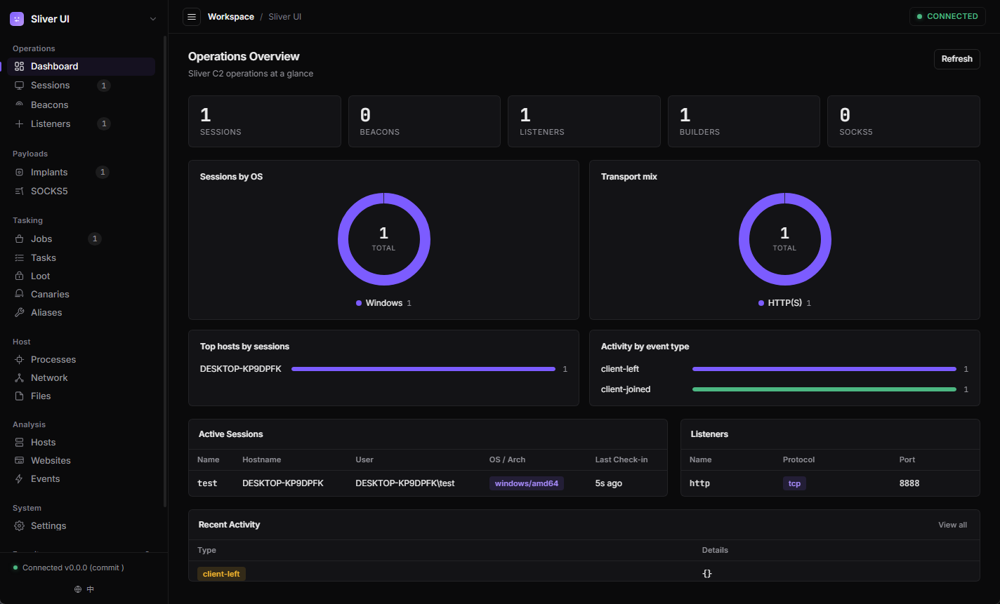
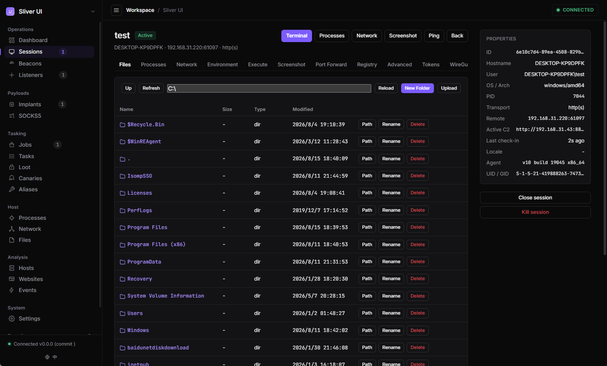
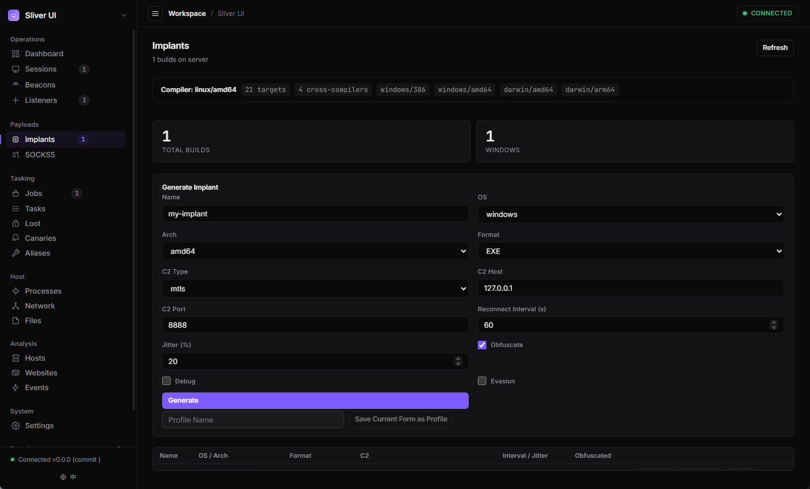
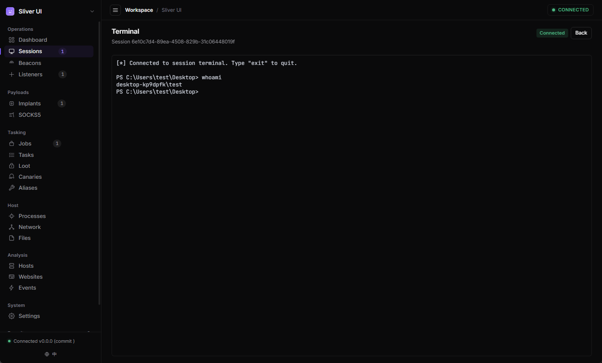

# Sliver UI

<p align="center">
  <strong>Sliver C2 uchun zamonaviy web va desktop konsol</strong><br>
  <a href="./README.md">English</a> · <a href="./README.uz.md">Oʻzbekcha</a>
</p>

<p align="center">
  <a href="https://github.com/9Insomnie/sliver_ui">
    
  </a>
  <a href="https://github.com/9Insomnie/sliver_ui/issues">
    
  </a>
  <a href="https://github.com/9Insomnie/sliver_ui">
    
  </a>
  <a href="https://github.com/9Insomnie/sliver_ui/releases">
    
  </a>
  <a href="./LICENSE">
    
  </a>
</p>

**Sliver UI** — ochiq manbali [Sliver](https://github.com/BishopFox/sliver) C2 / adversary simulation uchun grafik konsol. Backend **Sliver client**: serverga native gRPC (mTLS + token) orqali ulanadi va operatsiyalarni HTTP API qilib beradi. Frontend (React) brauzerda yoki Windows WebView2 oynasida chizadi.

Hammasi **bitta static binary**. Frontend `go:embed` bilan backend ichiga yigʻiladi.

Bu daraxt [`9Insomnie/sliver_ui`](https://github.com/9Insomnie/sliver_ui) forkidir: operator login, `install.sh`, HTTP C2 tahriri, host-compile Loaders va pastdagi P0/P1 operator-konsol ishlari qoʻshilgan. Faqat ruxsat etilgan lab / red-team.

```text
┌───────────────────────────────┐
│  Brauzer / WebView2 oyna      │
│  Sliver UI (React + xterm.js) │
└──────────────┬────────────────┘
               │  HTTP API / WebSocket
               ▼
┌───────────────────────────────┐
│  Go backend  (sliver client)  │
│  embed qilingan frontend + API│
└──────────────┬────────────────┘
               │  gRPC / RPC (mTLS + token)
               ▼
┌───────────────────────────────┐
│  Sliver Server                │
│  sessions · beacons · jobs    │
└───────────────────────────────┘
```

Protobuf pin: `github.com/bishopfox/sliver` **v1.7.3**. Shu forkdagi jonli lab Sliver **1.7.9**. `GET /api/builders` hali ham implant buildlarni `"builders"` kaliti ostida qaytaradi. Haqiqiy tashqi builder stansiyalari: `GET /api/external-builders`. `/jobs` marshruti saqlanadi.

## Skrinshotlar

| | |
| :-: | :-: |
| **Dashboard** — session, beacon, listener, SOCKS | **Sessions** — jadval/graf, teglar, solishtirish, privilege |
|  |  |
| **Implants** — generate, C2 vs jobs, SHA-256, limit, canary | **Terminal** — session uchun toʻliq ekran xterm.js |
|  |  |

## Halol OPSEC

Obfuscate va Evasion — compile-time flaglar. Unique SHA-256 faqat **aniq-hash qidiruvini** uradi; VirusTotal yangi hashni baribir sandbox qiladi. Go loader runtime ichida `VirtualAlloc` / `CreateThread` / `kernel32.dll` qoladi. HTTP C2 matni: **“This still looks like default Sliver to public detectors.”** Spoof metadata — PE VERSIONINFO/ikonka kloni, FUD emas. VirusTotal 0/70 yoki AV/ML bypass daʼvo qilinmaydi.

Kuzatuv: [`docs/P1_OPERATOR_WORK.md`](./docs/P1_OPERATOR_WORK.md) · tadqiqot: [`reports/Sliver UI imkoniyatlar tahlili.md`](./reports/Sliver%20UI%20imkoniyatlar%20tahlili.md) · loaderlar: [`docs/LOADER_AV_OPSEC_PLAN.md`](./docs/LOADER_AV_OPSEC_PLAN.md) · AV qatlamlar: [`docs/AV_LAYERS_CLOSE_PLAN.md`](./docs/AV_LAYERS_CLOSE_PLAN.md)

### Offline builder (targetda GitHub kerak emas)

```bash
./builder.sh install          # shu mashina: build + server+UI+systemd
./builder.sh pack             # dist/sliver-ui-bundle-*.tar.gz — boshqalarga berish
```

Qabul qiluvchi arxivni ochib `bash setup.sh` (Linux) yoki `setup.ps1` (Windows → WSL) ishlatadi. Bundle bu repoti GitHubdan yuklamaydi.

---

## Nimalar qilindi

Shu forkda ship qilingan ishlar, bosqichma-bosqich.

### 1. Mahsulot qobigʻi

- Bitta binary embed (`frontend/dist` → `backend/web/dist` → `go:embed`).
- Linear uslubidagi qorongʻu UI: `#0a0a0b` / `#131316` / accent `#7c5cff`, Inter 13px.
- i18n **English + 简体中文** birga yuritiladi (`i18n.test.ts` kalit daraxtlari ajralib ketsa yiqiladi).
- Sevimlilar, yigʻiladigan sidebar, ⌘K / Ctrl+K command palette (sahifalar, session, beacon, generate, listen).
- Sign out yuqori panelda. Settings System ostida qoladi. Jobs sidebardan olib tashlandi (`/jobs` marshruti saqlanadi; Listeners allaqachon joblarni koʻrsatadi).
- Boʻsh dashboard diagrammalari yashiriladi. Builders kartochkasi matni “Builds”.

### 2. Auth, install, systemd

- UI login: `SLIVER_UI_USER` / `SLIVER_UI_PASS` (`~/.config/sliver-ui/env`).
- Cookie `sliverui_session` HttpOnly SameSite=Lax 24 soat (Secure yoʻq; in-process map, restart sessiyani oʻchiradi).
- Middleware `/api/*` va `/ws/*` ni yopadi. Login, `/api/auth/me` va SPA ochiq.
- [`install.sh`](./install.sh): binary, profil `*.cfg` → `*.json`, localhost profilni avto-tanlash, env fayl, `sliver-ui.service`, `sliver.service` dan `Wants=`.
- Flaglar: `--addr`, `--profile`, `--user`/`--pass`, `--no-auth`, `--build`, `--with-server` (default), `--no-server`, `--replace-server`, `--prefix`, `--skip-systemd`, `--no-start`. `--replace-server` jonli `sliver.service` ni bundled patched unit bilan almashtiradi (User=cup, `~/.sliver`). Operator `--permissions all`. Proto nomlari `proto-idents.json` seed bilan server va UI da bir xil.
- Default listen `127.0.0.1:8080`. Windows GUI-subsystem + WebView2; Linux/macOS HTTP. Windows loglari `sliver-ui.log` ga yoziladi.

### 3. Loaders / AV OPSEC (`/loaders`)

Hostda **tayyor** PE / ELF / Mach-O compile qilinadi — `POST /api/loaders/build` vaqtinchalik Go moduli yozadi va `GOOS/GOARCH CGO_ENABLED=0 go build` qiladi. UI binaryni yuklab beradi. Asosiy oqim ZIP + mahalliy compile emas.

- Boʻsh XOR kalit 16 bayt random kalit bilan almashtiriladi (embed hech qachon plaintext emas).
- Har build: XOR ga aralashgan 16 bayt nonce, 4–24KiB `n.bin` pad, random API-nom `NameKey`, Go `-buildid` → **SHA-256 har safar oʻzgaradi**, operator XOR kaliti bir xil boʻlsa ham.
- Hide-console / background default yoqilgan (Windows `-H windowsgui`; Unix setsid) — persistencedan alohida. Startup persistence default oʻchiq: bitta usul, yoki **All** (Windows: HKCU Run + schtasks ONLOGON + Startup nusxa; Linux: user systemd + crontab `@reboot`; Darwin: faqat LaunchAgent, All yoʻq). Windowsda odatdagi tanlov HKCU Run. All shovqinliroq (uchta artefact).
- Windows **amd64/386** wrap — UI hostda **MinGW C** (`x86_64-w64-mingw32-gcc` / `i686-w64-mingw32-gcc`, `#embed`, ~oʻnlab KiB + blob). Mingw yoʻq → HTTP 503. **windows/arm64** va Linux/macOS Go stubda qoladi. C wrap Go PE-shakl ML (`gopclntab` / Wacatac) ni tashlaydi; xotiradagi `sliverpb` ni yashirmaydi va Defender jonli sessiyani saqlamaydi. XOR `cfg.dat`; PAGE_NOACCESS → RW → RWX; 8MiB stack + `CALL`; PIC qaytsa hang (`SLIV_BG=1` skip). RAM 2 GiB; `HAL9TH` chiqadi.
- Windows **EXE** ni wrap qilish rad etiladi (`format=shellcode` generate qiling). Shared DLL default **disk LoadLibrary** (C EXE + yonma-yon DLL, export StartW, `engine=mingw-c-dll`); Tools → RDI — unbacked PIC. Windows wrap **teng uzunlikda branding tozalash** (bishopfox import, `Go buildinf:`, ishlatilmaydigan COM eksport; disk DLL da StartW rename). Bundled patched serverda protobuf RPC nomlari allaqachon morph; `CleanImplant` stock `GetJitter` ni qoldiradi, patched generate da u yoʻq. Qolgan hitlar `clean.remaining`.
- Linux PIC (malasada): mmap RWX, fork/clone, assembly `CALL` 8MiB stackda (`jump_linux_*.s`). `syscall.Syscall(addr)` — syscall tuzogʻi, jump emas.
- Shuningdek: Sliver RDI, SGN/XOR encoder, TCP stage listener (ixtiyoriy AES/RC4). Windows shellcode generate default: Donut **Bypass=1** (AMSI patch yoʻq; CLI default 3 signature) va **ExitOpt=3** (block). Unique SHA-256 hash-IOC, Defender bypass emas.
- Implant `implant_builds.name` UNIQUE: xato map qilinadi + `replace_existing`.
- **Qilinmagan / qayta ochilmaydi:** in-tree Donut yoki ScareCrow, Implantsdagi FUD encrypt checkbox, VirusTotal vidjeti.

### 4. HTTP C2

- Sahifa `/http-c2`: roʻyxat + JSON editor, template `ms-update` va `jquery-cdn`.
- RPC: `GetHTTPC2Profiles` / `GetHTTPC2ProfileByName` / `SaveHTTPC2Profile`. Roʻyxat fingerprint oldidan nom boʻyicha toʻldiriladi.
- Default-fingerprint: “This still looks like default Sliver to public detectors.”
- TrafficEncoder xarita, **Add / Rm**, generate vaqtida encoder tanlash.
- HTTP listener kamuflaj: website, domain, ACME, OTP, long-poll.
- Generate maydonlari: `http_c2_profile`, `traffic_encoders*`, `limit_*`.

### 5. P0 — operator table-stakes

| Ish | Nima ship qilindi |
|---|---|
| Events | In-process ring (~500) + `/ws/events`, poll fallback. Beacon eventlari proto `Event.Data` dan unmarshaling (v1.7.3 da `Event.Beacon` yoʻq). |
| Beacon generate | Formada `is_beacon`, interval/jitter. |
| Beacon tasking | `Request.BeaconID` bilan ls / ps / exec / screenshot + `CancelBeaconTask`. Open-session delay / C2s. |
| Tashqi builderlar | `GET /api/external-builders` → `Builders()`. Eski `/api/builders` ImplantBuilds, kalit `"builders"`. |
| Operators | `GetOperators` sahifasi. |
| ⌘K palette | Sahifa, session, beacon, generate, listen. |
| C2 vs jobs | Implant / session `ActiveC2` jonli joblar bilan **nom + port** boʻyicha solishtiriladi (Job.Protocol koʻpincha `tcp`). |
| SHA-256 | Generate / regenerate / download; **boshqa nom** bilan toʻqnashsa ogohlantirish. |
| Screenshot / fayl → loot | `LootAdd` — tab yopilsa ham saqlanadi. |
| Generate da canary | `CanaryDomains` + Canaries sahifasi. |
| Armory | Minisign HTTP indeks; install **shu UI jarayonining** `aliases/` papkasiga yozadi. |

### 6. P1 birinchi kesma

| Ish | Nima ship qilindi |
|---|---|
| Sessions graf | Jadval / graf `PivotGraph()` ustida. Privilege highlight (`UID==0` yoki SYSTEM/root/Administrator). SOCKS / portfwd lenta. Latency uydirma emas. |
| Files recents | Host UUID boʻyicha, 8 ta, Backspace-yuqoriga. |
| Loot hisobot | `GET /api/loot/report?format=json\|md`. Credential *borligi* yoziladi; parol dump qilinmaydi. |
| Generate limitlari | `limit_datetime`, `limit_file_exists`, `limit_locale`. |
| External builder tanlash | `GenerateExternal` + `external-acknowledge` / failed / completed, keyin `Regenerate`. |
| Spoof metadata | `GenerateSpoofMetadata` PE source/icon — resource klon, FUD emas. |
| Beacon / session reconfigure | UI soniyalari → backend nanosekund (`time.Second`). Generate interval birligi soniyada qoladi. |
| BOF / extension run | Aliasesdan (`aliasRun` / `callExtension`). |
| PsExec default | Oddiy `OneDrive Updator` (avval `Sliver` edi). |

### 7. P1 qolganlari

| Ish | Nima ship qilindi |
|---|---|
| Wasm extension | Session va beacon da Register / list / exec. gzip BestSpeed, 64 MiB cap, memfs, loot. Session **pipe** tunnelni chiqish yoki **60s** gacha drain qiladi — jonli TTY emas. Beacon pipe qila olmaydi. HTTP-C2 traffic-encoder Wasm dan alohida. Handler fayli `handlers_wasiext.go` (`*_wasm.go` `GOARCH=wasm` deb eʼtiborsiz qolinadi). |
| rportfwd | Start / Get / Stop, **v1.7.3** RPC (go.mod bump yoʻq). Implant tinglaydi; teamserver dial qiladi. Faqat port bind → `:port`; faqat port remote → `127.0.0.1:port`. DNS ActiveC2 ogohlantiradi, baribir start. Reverse-tunnel I/O teamserverda (`rtunnels.TrackListener`). |
| Notes / teg / campaign | Sliver UUID kalitli mahalliy JSON. Yoʻl: `$SLIVER_UI_DATA` yoki `~/.local/share/sliver-ui/operator-store.json`. |
| Advisory lock | Banner “admin is on this session”. `sliver-client` eʼtibor bermaydi. Qattiq qulf uchun yangi Sliver RPC kerak. |
| Reactions | Allowlist `whoami` / `ps` / `pwd` / `ifconfig` / `screenshot`. Disk formati `~/.sliver-client/reactions.json` (`event_type` + `commands`). Bu sliver-client REPL emas. |
| Kim nima qildi | MUTATE log: cookie user + Sliver operator nomi (`Client.Profile`). Boshqa sliver-client operatorlari koʻrinmaydi. Toʻliq audit uchun yangi Sliver RPC kerak. Cap 500. |
| Session solishtirish | Ikki session: host, user, C2, mahalliy teglar. |

Session workspace **15 tab**: files, processes, network, env, exec, screenshot, portfwd, **rportfwd**, registry, advanced, **wasm**, tokens, wg, pivot, services — plus alohida `/sessions/:id/terminal`. Beacon detail da Wasm (pipe yoʻq) va notes.

---

## Yana nimalar qilinishi kerak

Imkoniyatlar hisobotidagi P0 va P1 **tugagan**. Qolgani P2 / keyinroq, plus hozirgi kesmaning ochiq cheklovlari.

### Keyingi operator ishi (P2)

| Ish | Nega ochiq | Fit |
|---|---|---|
| Interaktiv Wasm TTY | Hozirgi pipe chiqish yoki 60s gacha drain qiladi | Mavjud tunnel + jonli xterm; katta UX |
| Qattiq session qulfi | Advisory lock faqat shu UI host; CLI eʼtiborsiz | **Yangi Sliver RPC** |
| Toʻliq multi-operator audit | Bu UI faqat oʻz MUTATE + shu Sliver profilini yozadi | **Yangi Sliver RPC** |
| Fayl qoʻshimchalari: grep, cp, chmod, memfiles, mount | FS sirt qisman | Mavjud Sliver RPC |
| Listener RestartJobs, DNS canary/no-txt, cert RPC | Listeners hali jobs jadvali bilan bir | Mavjud Sliver RPC |
| Generate named-pipe / TCP pivot C2 | Forma mTLS/HTTP/HTTPS/DNS/WG ni qamrab oladi | Mavjud Generate maydonlari |
| Crackstation | Proto bor, tor lab ish | Mavjud Sliver RPC |
| Batch “profildan N unique hash generate” | Operator hash IOC uchun generate ni takrorlaydi | Backend helper, Generate loop |
| Ghostwriter / `mythic_sync` | Attributed taskingdan keyin hisobot | Backend helper |
| Qoʻshimcha i18n (FR/ES/JA, UI oʻzbekchasi) | UI faqat en+zh; OPSEC matnini notoʻgʻri tarjima qilish oson | UI-only, maintainer kerak |
| Team chat / spectator / RBAC | Mythic uslubidagi multiplayer | Yangi backend; env-paroldan uzoq |

### Yangi Sliver RPC yoki boshqa jarayon kutadi (shu UI da qilinmaydi)

- Crystal Palace (`execute-assembly` in-process) va **async BOF** — BishopFox [#2169](https://github.com/BishopFox/sliver/issues/2169) / [#2241](https://github.com/BishopFox/sliver/issues/2241) kutiladi.
- **Cursed** (Chrome) — pinlangan protobuf da RPC yoʻq.
- **MCP** — `sliver-client mcp` shu UI yonida ishlayversin.
- **AI operator** — bu embed konsol doirasida emas.

### Qilinmaydi

In-tree Donut / ScareCrow, encrypt-at-rest ni Implants checkbox qilib qayta yozish, VirusTotal vidjeti, FUD / 0/70 daʼvo, BloodHound overlay, cloud DNS, C2 ichida IronRDP, MITRE heatmap, kill-chain timer, Electron ga oʻtish. Arxitektura **teamserverda brauzer ochish** boʻlib qoladi.

### Shu hostdagi lab follow-up

- Jonli session ustida Wasm exec va rportfwd ni oxirigacha sinash (oxirgi verify da 0 callback bor edi; API va tablar bor, implant yoʻli isbotlanmagan).
- Reverse-portfwd forma default bind porti `8080` (UI listen porti bilan bir xil raqam; implant tomonda, lekin adashtirish oson).
- Who-ran-what da API testlardan qolgan `local` 503 qatorlar boʻlishi mumkin (store isolation dan oldin). Endi `TestMain` `$SLIVER_UI_DATA` ishlatadi.

---

## Tezkor oʻrnatish (server)

Allaqachon `sliver-client` (va yaxshisi `sliver.service`) bor hostda:

```bash
git clone https://github.com/9Insomnie/sliver_ui.git
cd sliver_ui
bash install.sh
```

Installer:

- `sliver-ui` binary ni qoʻyadi (mahalliy build, mavjud binary yoki GitHub release)
- `~/.sliver-client/configs/*.cfg` → `*.json`
- localhost operator profilini avto-tanlaydi
- UI loginni `~/.config/sliver-ui/env` ga yozadi
- `sliver-ui.service` ni yoqadi va `sliver.service` ga `Wants=` qiladi

```bash
bash install.sh --help
bash install.sh --addr 0.0.0.0:8080 --profile cup_127.0.0.1 --user admin --pass 'change-me'
bash install.sh --build          # shu daraxtidan majburiy make build
bash install.sh --no-auth        # UI loginni oʻchirish
```

Upstream release binarylari bu forkning auth / loaders / P0–P1 patchlaridan orqada qolishi mumkin. Shu daraxtidan `--build` afzal.

## Ishga tushirish

- **Windows** — native **WebView2** oyna (1440×900). Oddiy HTTP uchun `--no-window`.
- **Linux / macOS** — HTTP server; `--no-browser` boʻlmasa default brauzerni ochadi.

```
sliver-ui --no-window --addr 0.0.0.0:8080
```

| Flag           | Tavsif                                                         |
| -------------- | -------------------------------------------------------------- |
| `--addr`       | HTTP listen manzil (default `0.0.0.0:8080`)                     |
| `--profile`    | Start vaqtida saqlangan Sliver profiliga ulanish                |
| `--no-window`  | Desktop oynani tashlab ketish                                   |
| `--no-browser` | Brauzerni ochmaslik (server rejim)                              |

GUI-subsystem build konsol logini binary yonidagi `sliver-ui.log` ga koʻchiradi.

Ishlab turgan binaryni almashtirish “Text file busy” beradi: stop/kill, `cp` → `~/.local/share/sliver-ui/bin/sliver-ui`, qayta start. systemd `Restart=on-failure` SIGTERM da qayta ishga tushirmaydi.

Deploydan keyin brauzerni hard-refresh qiling (`Ctrl+Shift+R`). `index.html` — `Cache-Control: no-store`; hashlangan assetlar immutable.

## Sliver serverga ulanish

`sliver-client` kabi: operator `*.json` `~/.sliver-client/configs/` da (yoki `SLIVER_CLIENT_CONFIGS`).

```
sliver-client config generate <operator>
```

1. **Settings:** config faylni yuklash, operator / lhost / lport ni tasdiqlash, Connect. Saqlangan profillar bir bosishda almashtiriladi.
2. **Startup:** `sliver-ui --profile <operator>`.

Session, beacon, loot, host — Sliver serverda. Bu UI UI hostida **mahalliy** operator store ham tutadi (`operator-store.json`): teglar, notes, advisory lock, reactions, mutate audit.

## Imkoniyatlar (hozirgi)

### Sidebar

| Boʻlim     | Sahifalar                                                    |
| ---------- | ------------------------------------------------------------ |
| Operations | Dashboard, Sessions, Beacons, Listeners                      |
| Payloads   | Implants, Loaders, HTTP C2 Profiles, SOCKS5                  |
| Tasking    | Tasks, Loot, Canaries, Aliases, Armory                       |
| Host       | Processes, Network, Files                                    |
| Analysis   | Hosts, Websites, Events                                      |
| System     | Operators, Settings                                          |

Jonli count badge, sevimlilar, tor ekranda yigʻilish. `/jobs` marshrut sifatida qoladi.

### Sessions

Qidiruv / sort / inline rename / kill / prune, jadval **yoki** pivot graf, teglar, ikki session solishtirish, privilege highlight, SOCKS/portfwd lenta.

Detail workspace (15 tab) + toʻliq ekran terminal. Sidebar: xususiyatlar, operator notes, advisory lock. Ping / Rename / Kill / Close.

### Beacons

Rename, monitor, prune, task tarixi, exec/ps/ls/screenshot navbati, task bekor qilish, interval/jitter/C2URI reconfigure, interaktiv session ochish, Wasm (pipe yoʻq), notes.

### Implants va listenerlar

Generate: OS/arch/format, C2 turi, HTTP C2 profil, traffic encoder, `is_beacon`, canary domain, SHA-256, `limit_*`, external builder, spoof metadata, `replace_existing`. Profil, download / regenerate / delete.

Listenerlar: mTLS, HTTP(S), DNS, WireGuard, HTTP kamuflaj. Formada C2 vs jonli joblar.

### Loaders, loot, armory

Loaders: Build EXE, RDI, stage AES/RC4. Loot: fayl va creds, JSON/MD hisobot. Armory → shu jarayon `aliases/` papkasi. Aliases tar.gz install/run.

### Settings qoʻshimchalari

Reactions (CLI `reactions.json`) va **Who ran what** (faqat shu UI).

## Texnologiyalar

| Qatlam    | Stack                                                        |
| --------- | ------------------------------------------------------------ |
| Frontend  | React 18, TypeScript, Vite 5, react-router, i18next, xterm.js, Vitest |
| Backend   | Go 1.25, `net/http`, WebSocket terminal + events             |
| Desktop   | WebView2 (`github.com/jchv/go-webview2`, faqat Windows)      |
| Sliver    | `github.com/bishopfox/sliver` v1.7.3 gRPC client             |

Ildizda `go.mod` yoki `package.json` yoʻq. Buyruqlarni `frontend/` yoki `backend/` dan, yoki Makefile orqali yuring.

## Manbadan build

Go va Node.js kerak.

```
make build          # frontend + embed + Go binary → ./sliver-ui
make dev            # API :8080 + Vite :5173 (/api va /ws proxy)
make test
make vet
make clean
```

UI ishi uchun `make dev`. `go run .` yolgʻiz `frontend/dist` hech qachon copy qilinmagan boʻlsa boʻsh embed beradi.

Windows, Linux va macOS (amd64 + arm64) binarylari [releases](https://github.com/9Insomnie/sliver_ui/releases) da. CI: frontend `npm ci && npm run build && npm test`, backend `go vet ./... && go test ./...`.

## Litsenziya

[MIT](./LICENSE)

*Sliver UI faqat ruxsat etilgan xavfsizlik baholashlari, red-team, adversary simulation, tadqiqot, CTF va izolyatsiya qilingan lablar uchun.*
